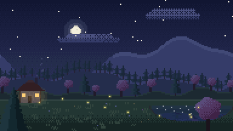
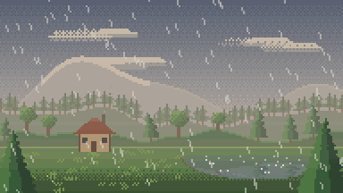
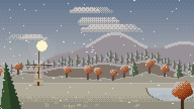

# Pixel World Generator

Procedural pixel-art landscapes that are alive: clouds drift, trees sway, smoke rises, fireflies
wander, rain ripples the lake. Pick a **seed**, the **time of day** and the **weather**, then export
the scene as a **seamless looping GIF**.

<p align="center">
  
  
  
</p>

## Features

- **Seeded worlds** — the same seed always produces the same world: mountains, forests, a lake,
  and a landmark (cottage, shrine or windmill) across four biomes (temperate, autumn, sakura, boreal).
- **Time of day** — a 24-hour slider drives sky colour, sun and moon arcs, stars, aerial haze,
  and lights that switch on at dusk.
- **Weather** — clear, clouds, rain, snow or fog, each with an intensity slider. Snow settles on
  the ground, roofs and trees, and freezes the lake when it is heavy.
- **Perfect loops** — every animation completes a whole number of cycles in 72 frames (7.2 s),
  so the GIF has no visible seam.
- **GIF export** at 2×–8× with crisp, nearest-neighbour pixels and one shared palette (no colour flicker).
- **Shareable links** — settings are stored in the URL hash, e.g. `#seed=42&time=21.5&weather=clear&intensity=0.6`.

## Development

```bash
npm install
npm run dev     # local dev server
npm test        # determinism + seamless-loop self-check
npm run build   # production build in dist/
```

The scene is rendered at 192 × 108 into a plain RGBA buffer (`src/raster.ts`), so the same code
draws the live preview, encodes the GIF and runs in the tests.

| File | Role |
|---|---|
| `src/world.ts` | Generates the world layout from a seed |
| `src/lighting.ts` | Sky, light tint and haze for any hour and weather |
| `src/render.ts` | Draws one animation frame |
| `src/gif.ts` | Renders the loop and encodes the GIF ([gifenc](https://github.com/mattdesl/gifenc)) |
| `src/main.ts` | Controls and live preview |

## Deployment

Pushing to `main` builds and deploys the site with GitHub Actions. In the repository settings,
set **Pages → Build and deployment → Source** to **GitHub Actions** once.

## License

[MIT](LICENSE)
