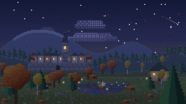
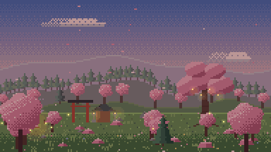
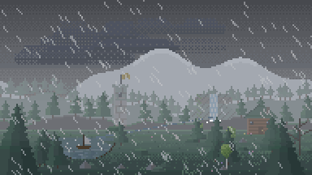
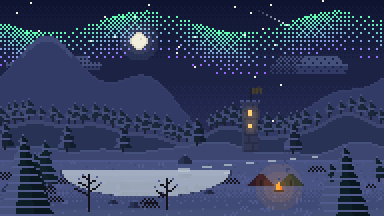
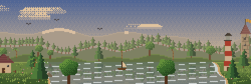

# Pixel World Generator

Procedural pixel-art worlds that are alive: castles and villages, lighthouses and ruins, seas, storms,
auroras and falling leaves. Pick a **seed**, the **time of day**, the **weather** and the **season**,
choose a frame for your destination, and export a **seamless looping GIF**.

**[Open the generator →](https://me4chi.github.io/pixel-world-generator/)**

<p align="center">
  
  
  
  
</p>
<p align="center">
  
</p>

## Features

**Worlds**
- 8 biomes: temperate valley, autumn hills, sakura glade, boreal ridge, desert, tundra, misty swamp, sea coast.
- 22 kinds of landmarks with variations: cottages, timber-frame houses, windmills, watermills, castles,
  walled towns with a church spire, villages with a well, farms with a barn and scarecrow, watchtowers,
  lighthouses, shrines, pagodas, ruins, stone circles, ancient trees, camps, pyramids with an obelisk,
  oases, igloos, stilt huts, bridges and waterfalls.
- Nature: 7 tree species (pine, broadleaf, birch, palm, cactus, willow, dead tree), bushes, rocks,
  flowers, grass; lakes, rivers, swamp ponds and seas.
- 4 world sizes (128×72 to 384×216 pixels): a bigger world shows more landscape and more landmarks
  at the same pixel scale.

**Time, weather and seasons**
- 24-hour light: dawn, day, golden hour, dusk and night with stars and moon; windows and lanterns light up after dark.
- Weather: clear, clouds, rain (with a rainbow after a light shower), thunderstorm with lightning, snow, fog.
- Seasons: spring blossom and petals, summer, autumn colours and falling leaves, winter snow, bare trees and frozen lakes.
- **Time-lapse**: a whole day passes in one loop.

**Life**
Drifting clouds, swaying trees and grass, chimney smoke, turning windmills and water wheels, waving
banners, a rotating lighthouse beam, campfires, fireflies, birds, boats, jumping fish, grazing sheep,
northern lights and shooting stars.

**Output**
- Frames for every destination: 16:9, 1:1 avatar, 9:16 phone/stories, 2:1 social preview, 3:1 banner.
- **Panorama**: the world becomes a ring and the camera glides around it — still a seamless loop.
- Palettes: Game Boy, PICO-8, NES, Commodore 64, sepia, neon night, 1-bit, or your own colours.
- Optional caption in a pixel font; layers (clouds, buildings, life, weather) can be switched off.
- Export a **GIF** (pixel scale 1–8×, size estimate before export), a **PNG** frame, a **sprite sheet**
  of all frames, or a **WebM** video.
- Loop length and frame rate are adjustable; every motion completes a whole number of cycles, so loops
  never show a seam.
- Shareable links, a gallery of saved worlds, recent seeds, English and Russian interface.

## Command line

The renderer is plain TypeScript, so the same worlds render without a browser:

```bash
npm install
npm run cli -- --seed 42 --biome coast --time 21 --weather storm --format banner --size large --scale 4 --out world.gif
```

Every option of the website is available with the same name as in the share link:
`--seed --biome --format --size --pan --time --timelapse --weather --intensity --season --palette --colors --frames --fps --layers --caption`,
plus `--scale` and `--out`.

## World of the day

`.github/workflows/daily.yml` renders a new world every morning (the date is the seed) and publishes it to
the `daily` branch. Embed it anywhere, for example in a GitHub profile README:

```html
<a href="https://me4chi.github.io/pixel-world-generator/">
  
</a>
```

## Development

```bash
npm run dev     # local dev server
npm test        # determinism, seamless loops in every biome and mode, palettes, links, GIF encoding
npm run build   # type-check and production build in dist/
```

| File | Role |
|---|---|
| `src/world.ts` | Generates terrain, water, rivers, landmarks and props from a seed |
| `src/biomes.ts` | Biomes, seasons and how they look |
| `src/structures.ts` | Drawing of all 22 landmark kinds |
| `src/flora.ts` | Tree species with wind and seasons |
| `src/effects.ts` | Sky, clouds, water, weather, lightning and life |
| `src/render.ts` | Puts one frame together; panoramas, captions, palettes |
| `src/lighting.ts` | Light for any hour and weather |
| `src/gif.ts` | Rendering a loop and GIF encoding with changed-pixels-only frames ([gifenc](https://github.com/mattdesl/gifenc)) |
| `src/worker.ts` | Exports in a Web Worker, so the page never freezes |
| `src/state.ts` | Settings ⇄ share link ⇄ CLI flags |
| `src/main.ts` | Interface |

Pushing to `main` deploys the site with GitHub Actions (**Settings → Pages → Source: GitHub Actions**).

## License

[MIT](LICENSE)
